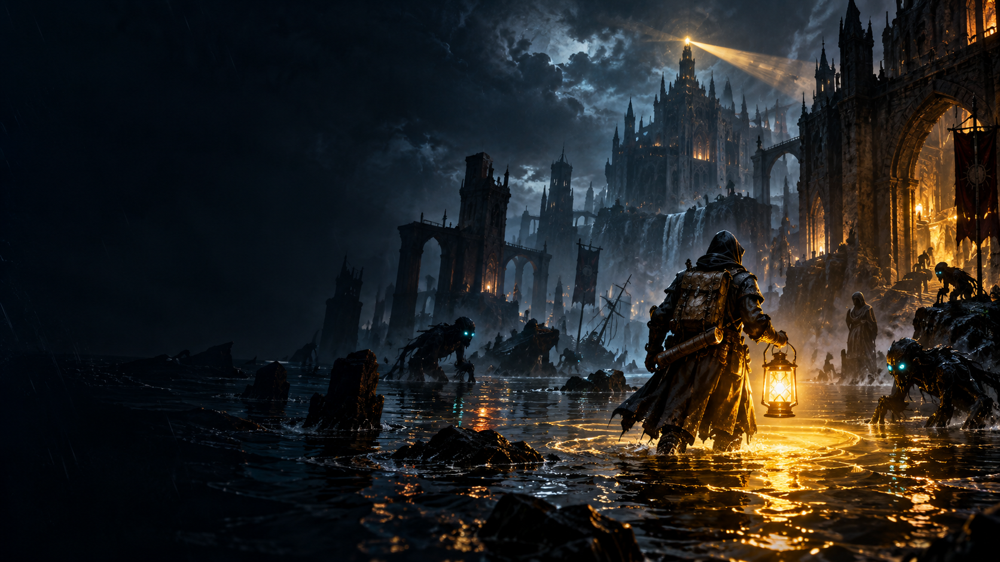

<div align="center">
  

  <h1>CINDER SIGNAL: NIGHT DISPATCH</h1>
  <p><strong>Prototipo 2D de acción y supervivencia táctica para PC</strong></p>
  <p>La linterna es tu herramienta de combate, tu fuente de información y un recurso limitado.</p>

  
  
  
</div>

---

## Sobre el proyecto

**CINDER SIGNAL: NIGHT DISPATCH** es un prototipo jugable de vista cenital 2D. Su mecánica central gira alrededor de una linterna que permite apuntar, revelar amenazas y combatir mientras el jugador administra su carga y decide cuándo avanzar o retirarse.

Esta build está preparada para probar los ocho sectores de la campaña desde el menú. El proyecto continúa en desarrollo y no representa una versión comercial final.

## Características

- Combate centrado en la linterna y la gestión de su carga.
- Movimiento animado del protagonista y efectos de iluminación en Canvas 2D.
- Criaturas con siluetas y comportamientos diferentes.
- Ocho sectores con ambientación, enemigos y enfrentamientos de jefe.
- Progresión mediante experiencia, ecos y mejoras.
- Interfaz en español e inglés.
- Guardado local en el navegador; no requiere una cuenta ni un servidor.
- Opción de escritorio mediante Electron.

## Cómo ejecutar el juego

### Navegador en Windows

1. Descarga o clona el repositorio.
2. Ejecuta `JUGAR_CINDER_SIGNAL.bat` o abre `index.html` en un navegador moderno.
3. Si el guardado local no funciona al abrir el archivo directamente, prueba con otro navegador o ejecuta el proyecto desde un servidor local estático.

Esta opción no necesita instalar dependencias de Node.js.

### Aplicación de escritorio (opcional)

Requisitos: Node.js LTS y npm. La instalación de dependencias requiere conexión a Internet.

```bash
npm install
npm start
```

Para generar un instalador de Windows:

```bash
npm run dist:win
```

La salida se guarda en `dist/`. El instalador es una herramienta de desarrollo y todavía necesita pruebas antes de una distribución general.

## Controles

| Acción | Control |
|---|---|
| Moverse | `W`, `A`, `S`, `D` o flechas |
| Apuntar la linterna | Ratón |
| Mantener el haz de luz | Botón izquierdo del ratón |
| Pulso de emergencia | `E` o botón derecho del ratón |
| Desplazamiento rápido | `Espacio` |
| Disipar enemigos | `Q` — una vez por turno |
| Pausar o reanudar | `Esc` |
| Cambiar idioma | Botón `ES / EN` del menú |

## Tecnologías

- **HTML5** para la interfaz.
- **CSS3** para el diseño adaptable y los efectos visuales.
- **JavaScript** para la lógica del juego y la progresión.
- **Canvas 2D** para dibujar escenario, personajes, iluminación y efectos.
- **Electron y Node.js** para la opción de escritorio.

## Estructura

```text
├── index.html
├── style.css
├── game.js
├── main.cjs
├── package.json
├── JUGAR_CINDER_SIGNAL.bat
├── CREAR_APP_CINDER_SIGNAL.bat
├── CHANGELOG.md
├── NOTICE.md
└── assets/
    ├── keyart.png
    ├── creatures/
    ├── creature-sprites/
    └── maps/
```

## Estado actual

- **Versión:** 0.7.0.
- **Enfoque:** combate con linterna, movimiento del protagonista y pruebas de los ocho sectores.
- **Estado:** prototipo en desarrollo. El equilibrio, el rendimiento en diferentes equipos, la accesibilidad y la compatibilidad deben seguir probándose.

## Uso del repositorio

Este repositorio se comparte como muestra de portfolio y para revisión técnica. No se incluye una licencia de código abierto ni una autorización automática para reutilizar o redistribuir el código o los recursos. Antes de distribuir o comercializar el proyecto, verifica los derechos de todos los recursos utilizados y la disponibilidad del nombre.

---

<div align="center">
  <sub>Proyecto de desarrollo independiente · Build 0.7.0 · En desarrollo</sub>
</div>
